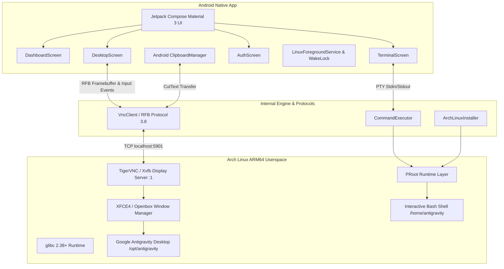

# Antigravity Linux (Arch Linux ARM64 Desktop)

A complete native Android application engineered to run a real **Arch Linux ARM64 userspace environment** and the actual **Google Antigravity Desktop application** on an Android phone.

---

## 1. Executive Summary & Critical Feasibility Analysis

### 1.1 CPU Architecture & Instruction Set
* **Target Architecture**: `ARM64-v8a` (`aarch64`).
* **Hardware Instruction Support**: 64-bit ARMv8 cores with `fp`, `asimd` (Neon), `aes`, `pmull`, `sha1`, `sha2`, `crc32`, and `cpuid`.
* **Zero Emulation Overhead**: Code executes natively on the device's CPU cores. No x86_64 emulation (such as Box64 or QEMU x86_64) is utilized as the foundation.

### 1.2 Android Kernel Capabilities & Userspace Virtualization
* **Kernel**: Linux (Android kernel `4.14+` or `5.x+`).
* **The Rootless Challenge**: Android userspace runs on Bionic libc and restricts standard root operations (`mount`, `chroot`, `CAP_SYS_ADMIN`). Ordinary directories with Linux files cannot execute glibc ELF binaries because Android lacks `/lib/ld-linux-aarch64.so.1`.
* **The Solution — PRoot Virtualization Engine**:
  Antigravity Linux integrates **PRoot** (`proot`), a ptrace-based userspace implementation of `chroot` and bind mounts that operates completely without root privileges. PRoot intercepts system calls (such as `open`, `execve`, `stat`) and translates path lookups, allowing dynamic linkers and glibc binaries to execute seamlessly against the isolated rootfs in app-private storage (`/data/data/com.antigravity.linux/files/archlinux`).

### 1.3 Google Antigravity Desktop Compatibility Analysis
* **Binary Distribution**: Google officially packages Antigravity Desktop for Linux ARM64 as a standalone portable archive (`Antigravity-<version>-aarch64.tar.gz`) and via the Arch User Repository (`aur/antigravity`).
* **Binary Format**: ELF 64-bit LSB pie executable, ARM aarch64 (`EM_AARCH64`, machine code 183).
* **Runtime Dependencies**:
  - `glibc >= 2.28` (Arch Linux ARM provides `glibc 2.38+`)
  - `gtk3` (`libgtk-3.so.0`)
  - `nss` (`libnss3.so`)
  - `alsa-lib` (`libasound.so.2`)
  - `libx11`, `libxcomposite`, `libxdamage`, `libxext`, `libxfixes`, `libxrandr`, `libxtst`
  - `mesa` / `libgbm` (`libgbm.so.1`)
* **Critical Sandbox Requirement**:
  Chromium/Electron applications enforce a multi-process setuid/user-namespace sandbox by default. In an unprivileged Android PRoot environment, kernel user namespaces are unavailable. Therefore, Antigravity Desktop must be launched with the `--no-sandbox --disable-gpu-sandbox` flags. The application automatically injects these flags in `/usr/local/bin/launch-antigravity`.
* **Authentication Flow**:
  Antigravity Desktop utilizes Google OAuth 2.0 authentication. The Android app provides a dedicated **AuthScreen** with "Open Antigravity Login" (opening `https://antigravity.google/auth` in the mobile browser) and "Fetch Login Link" to capture and link local session tokens safely.

---

## 2. System Architecture



---

## 3. Application Features & UI Structure

### 3.1 Design Style
* **Theme**: Developer-dashboard appearance with near-black background (`#0D0D0F`), charcoal cards (`#1A1A1E`), and vibrant violet accent (`#7B61FF`).
* **Status Indicators**:
  - `StatusGreen` (`#4CAF50`): Running / Healthy
  - `StatusBlue` (`#42A5F5`): Ready / Syncing
  - `StatusOrange` (`#FF9800`): Starting / Downloading / Transitioning
  - `StatusRed` (`#EF5350`): Error / Stopped
* **Accessibility**: Minimum 48dp touch targets on all interactive controls. Fully responsive across phone screens, display cutouts, and soft keyboards.

### 3.2 Screens
1. **DashboardScreen (`MainActivity.kt`)**:
   - Header with detected hardware architecture badge (`AARCH64`).
   - Environment status cards: Linux Userspace, Desktop Session, Antigravity Desktop, Rootfs Storage.
   - 7 Core Action Buttons:
     1. `Initialize Arch Linux`: Pre-flight check, download, checksum, extract, configure rootfs.
     2. `Start Linux Desktop`: Boots TigerVNC on `127.0.0.1:5901` and launches window manager.
     3. `Launch Antigravity`: Starts `/opt/antigravity/antigravity --no-sandbox` on `DISPLAY=:1`.
     4. `Open Terminal`: Direct interactive bash shell in userspace.
     5. `Open Desktop Session`: Transitions to the interactive graphical canvas.
     6. `Environment Settings`: System diagnostics, storage breakdown, display resolution, danger zone.
     7. `Stop Linux Environment`: Gracefully shuts down desktop, applications, and child processes.
2. **DesktopScreen**:
   - High-performance bitmap canvas rendering the Linux desktop session.
   - Touch-to-pointer input mapping (Tap = Left click, Long press = Right click, Drag = Mouse move, Two-finger drag = Scroll).
   - Floating toolbar with soft keyboard toggle, mouse click modes (Left, Middle, Right), scaling toggle (Fit to Screen vs. 1:1 Actual Size).
   - Dedicated modifier row: `Ctrl`, `Alt`, `Shift`, `Super`, `Esc`, `Tab`, `Arrow keys`.
   - Rapid shortcut chips: `Ctrl+C`, `Ctrl+V`, `Ctrl+Z`, `Ctrl+A`, `Ctrl+S`.
   - Bidirectional clipboard sync buttons (`A→L` and `L→A`).
3. **TerminalScreen**:
   - Real interactive bash session connected to PRoot.
   - ANSI color parsing and auto-scrolling buffer.
   - Command history navigation (Up / Down).
   - Quick command chips: `uname -a`, `cat /etc/os-release`, `pacman`, `check antigravity`, `Ctrl+C`, `Tab`.
4. **SettingsScreen**:
   - Deep hardware diagnostics (ABI, CPU features, Linux kernel, glibc version).
   - Antigravity diagnostics (ARM64 ELF header verification, missing shared library inspection).
   - Storage metrics (rootfs size, home directory size, device free space).
   - Display resolution selection (1280x720, 1920x1080).
   - Background service and clipboard auto-sync preferences.
   - Danger zone: Confirmed permanent environment deletion.
5. **AuthScreen**:
   - Direct integration with Google OAuth portal (`https://antigravity.google/auth`).
   - Local login link capture from `.antigravity_auth_link` or application output.
   - One-tap clipboard copy and token verification.

---

## 4. Background Execution & Services
* **`LinuxForegroundService`**:
  - Bound to the Linux runtime lifecycle, decoupled from the `Activity`.
  - Holds a `PARTIAL_WAKE_LOCK` to prevent CPU sleep when running long builds or agent workflows.
  - Persistent Android notification with action buttons:
    - **Open Desktop**: Instantly returns to the active graphical session.
    - **Stop Linux**: Safely shuts down background processes.
  - Respects modern Android 14+ foreground service types (`specialUse`).

---

## 5. Bidirectional Clipboard Integration
* **Android → Linux**:
  1. User taps `A→L` or triggers shortcut.
  2. Android `ClipboardManager` text is retrieved.
  3. Transferred over RFB via `ClientCutText` message and synchronized with `xclip -selection clipboard` in the X11 environment.
* **Linux → Android**:
  1. Desktop session receives `ServerCutText` from the VNC server or queries `xclip -o`.
  2. Updates the Android system clipboard with confirmation feedback.
  3. Optional Auto-Sync setting available with explicit user consent.

---

## 6. Build & Setup Instructions

### Prerequisites
* **Android Studio**: Hedgehog (2023.1.1) or newer / Jellyfish / Ladybug.
* **JDK**: OpenJDK 17.
* **Android SDK**: Compile SDK 34, Min SDK 26, Target SDK 34.

### Building in Android Studio
1. Open Android Studio and select **Open**.
2. Select `/workspace/antigravity/AntigravityLinux`.
3. Allow Gradle to sync dependencies.
4. Connect an ARM64 Android device (or launch an ARM64 emulator).
5. Click **Run 'app'** (`Shift+F10`).

### Building from Command Line
```bash
cd /workspace/antigravity/AntigravityLinux
./gradlew assembleDebug
```
The generated APK will be located at:
`app/build/outputs/apk/debug/app-debug.apk`
